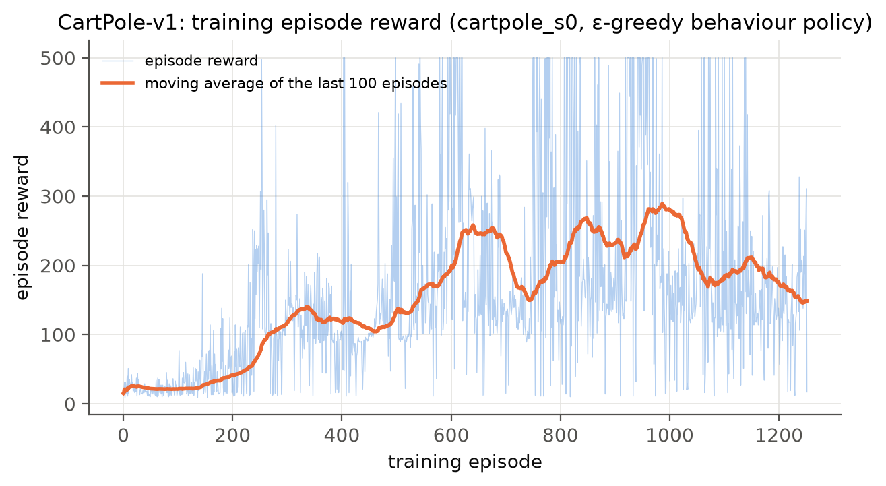
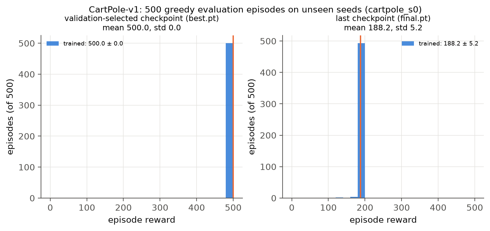
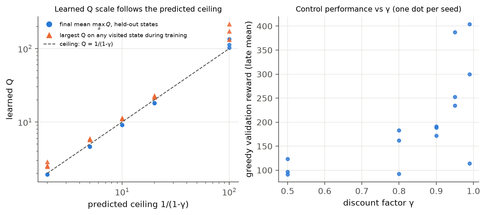
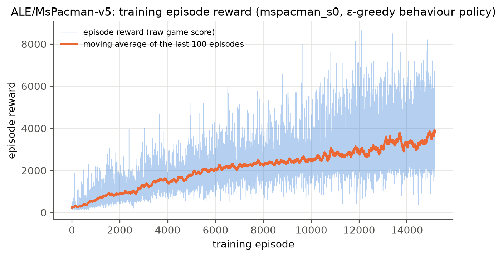
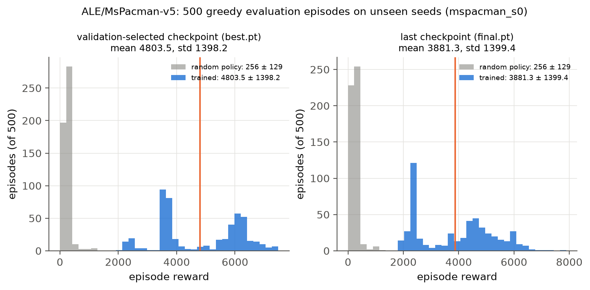
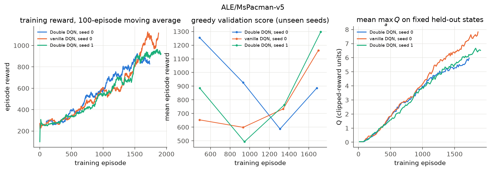

# Submission information {-}

| | |
|---|---|
| GitHub username | `weicheng998` |
| Repository | `mlds490-assignment2` — <https://github.com/weicheng998/mlds490-assignment2> |
| Code | everything is in `dqn/` · launch scripts: `scripts/` · logs and figures: `results/` |
| Compute | deepdish3, one RTX 2080 Ti per run (`CUDA_VISIBLE_DEVICES`), conda env `myenv`, PyTorch 2.14 cu126, `gymnasium[atari]==1.0.0`, `ale-py==0.10.1`. CPU-only validation scripts ran on my laptop |

**How to run** (full details in `README.md`):

```bash
pip install -r requirements.txt
# CartPole: 5 seeds on GPU 0, then 500-episode tests of best.pt / final.pt
nohup bash scripts/run_cartpole.sh 0 > logs/cartpole.log 2>&1 &
# MsPacman: <gpu> <seed> <double 0|1>; one GPU per run
nohup bash scripts/run_mspacman.sh 1 0 1 > logs/mspacman_s0.log     2>&1 &
nohup bash scripts/run_mspacman.sh 2 1 1 > logs/mspacman_s1.log     2>&1 &
nohup bash scripts/run_mspacman.sh 3 0 0 > logs/mspacman_s0_dqn.log 2>&1 &
bash scripts/eval_mspacman.sh 1        # 500 test episodes per run + random baseline
# validation (CPU is enough)
python -m dqn.validate --allow-cpu
python -m dqn.validate --allow-cpu --tests pacman_env
python -m dqn.ablate --group ablation --seeds 5 --jobs 9 --allow-cpu
python -m dqn.ablate --group gamma    --seeds 3 --jobs 9 --allow-cpu
python -m dqn.plot && bash report/build.sh   # figures, summary.json, this PDF
```

Training and evaluation require CUDA and stop with an error at startup if it is missing. `--allow-cpu` exists only for smoke tests and the CPU-only validation scripts. Each run uses a single GPU. Runs checkpoint atomically and resume when the same command is started again.

**Where the numbers come from.** Every number in this report is read from a log or result file in `results/`. The figures are produced by `dqn/plot.py`, and the numbers in the text are filled in from `results/summary.json` by `report/build.py`, which refuses to build if a value is missing.

**How validation was approached.** As in Assignment 1, I wrote down the expected outcome before running each test, and I compared against something that does not share code with the agent wherever I could: a closed form, exact value iteration, an independent numpy computation, or a reference distribution. Five of my predictions were wrong or only partly right. They are marked where they occur (Sections 2.4 and 4), together with what they showed. I am still learning this subject, so the measurements in this report are what I am sure of; the explanations I attach to them are my current understanding, and I try to say where I have not checked them.

# The algorithm (shared by both games)

One implementation (`dqn/agent.py`, `dqn/replay.py`, `dqn/train.py`) is used for both games. Only the network and the hyperparameters differ.

**Update rule.** A transition $(s,a,r,s',\text{cut})$ is drawn uniformly from the replay buffer and the online network $Q_\theta$ is regressed on

$$y \;=\; r+\gamma\,(1-\text{cut})\;Q_{\bar\theta}\bigl(s',\,\arg\max_{a'}Q_\theta(s',a')\bigr),$$

with the Huber loss between $Q_\theta(s,a)$ and $y$. $Q_{\bar\theta}$ is the **target network**, a copy of the online network that is refreshed every fixed number of gradient steps (hard sync). The online network chooses the next action and the target network evaluates it (Double DQN); `--double 0` gives the original $\max_{a'}Q_{\bar\theta}(s',a')$. The behaviour policy is $\varepsilon$-greedy with a piecewise-linear $\varepsilon$ schedule, and the learning rate decays linearly.

**Terminal versus truncation.** `cut` is 1 only when the episode really ended at $s'$: the pole fell or the cart left the track in CartPole; a life was lost or the game ended in MsPacman. When an episode is stopped by a time limit (500 steps in CartPole-v1, 108,000 emulator frames in MsPacman-v5) the task itself has not ended, so `cut` stays 0, the true next observation is stored, and the target still bootstraps from it. Section 4 shows what happens when this is done wrong.

**Hyperparameters.**

| | CartPole-v1 | MsPacman-v5 |
|---|---|---|
| Discount $\gamma$ | 0.95 | 0.99 |
| Network | MLP 4–128–128–2 | conv 32@8×8/4, 64@4×4/2, 64@3×3/1, FC 512, 9 outputs |
| Input | the 4 state variables | 4 stacked frames from the handout `preprocess_observation` (88×80, int8), divided by 128 |
| Parallel environments | 1 | 8 (worker processes), one GPU |
| Replay buffer | 200,000 transitions (whole run) | 500,000 transitions |
| Batch · update frequency | 128 · every step | 32 · one update per 4 agent steps |
| Optimizer | Adam, lr $10^{-3}\to10^{-5}$ linear | Adam, lr $10^{-4}\to2.5\times10^{-5}$ linear, $\epsilon_{\text{Adam}}=10^{-5}$ |
| Loss · gradient clipping | Huber · norm 10 | Huber · norm 10 |
| Target network | hard sync every 500 updates | hard sync every 2,500 updates (10,000 agent steps) |
| $\varepsilon$ schedule | 1 $\rightarrow$ 0.05 over 10k steps, $\rightarrow$ 0.01 at 50k | 1 $\rightarrow$ 0.1 over 1M steps, $\rightarrow$ 0.01 at 4M |
| Warm-up before learning | 1,000 buffer slots | 50,000 buffer slots |
| Training reward | raw (+1 per step) | $\operatorname{sign}(r)\in\{0,1\}$ (clipped) |
| Bootstrap cut | termination | termination or life lost |
| Training length | 200,000 steps | {{mspacman_s0|training|steps:,}} agent steps ({{mspacman_s0|training|episodes:,}} episodes) |
| Periodic validation | 100 greedy episodes every 5,000 steps | 30 greedy episodes every 250,000 steps |

**Reward scaling and units.** CartPole rewards are used as they are, so CartPole Q-values are in "steps": the true value can never exceed $\sum_k\gamma^k=1/(1-\gamma)=20$. MsPacman rewards are clipped to their sign for training, so MsPacman Q-values are in *clipped-reward units* (roughly "discounted number of reward events before the next lost life"), with a ceiling of $1/(1-\gamma)=100$. Every reward plot, histogram and score in this report is the **raw game score**.

**Definition of "maximum Q-value".** For plot (i) I log, for every training episode, the maximum over the states visited in that episode of $\max_aQ_\theta(s,a)$, computed with the online network at the moment the state was visited. This number depends on which states the episode happened to visit, so I also log the mean of $\max_aQ_\theta(s,a)$ over a *fixed* set of held-out states (1,000 for CartPole, 2,048 for MsPacman, collected once with a random policy on seeds that are never used for training). The fixed-state curve only changes because the network changes. Both are in the plots.

**Seeds and leakage.** Every episode has an explicit seed. Training episodes use seeds below $10^8$, periodic validation uses $2\cdot10^9+i$ and the final test uses $10^9+i$. `best.pt` is the checkpoint with the best validation score (ties go to the later one); `final.pt` is the last network. The 500 test episodes are never looked at during training or selection, and I report both checkpoints.

**Design decisions.**

* *One code path.* CartPole is the same agent with a 1-frame "stack" and 1 environment, so the tests on CartPole and on the tabular MDP exercise the code that trains MsPacman.
* *Replay storage.* The buffer stores single frames (int8) and rebuilds 4-frame stacks when sampling, which is 4× smaller than storing stacked states. The last observation of every episode gets its own non-sampleable slot, so the next state of any transition is simply "the stack ending one slot later", also at a truncation.
* *Life loss as a bootstrap cut in MsPacman.* The game continues after a lost life, so this is a modeling choice rather than a fact about the environment. My reasoning was that it tells the agent directly that dying is bad (otherwise the only penalty is the missing future reward several hundred steps later). The price is that Q is a "value until the next death", which is what the calibration plot in Section 3 compares against.
* *Reward clipping.* As I understand it, clipping keeps the TD errors in the range where the Huber loss is well behaved and lets the CartPole learning-rate scale carry over. It also makes the agent indifferent between a 10-point pellet and a 200-point ghost; the consequence is discussed in Section 3.
* *Sticky actions and frame skip.* I kept the `v5` defaults (frame skip 4, sticky-action probability 0.25, 9 actions) because the assignment names this version. Sticky actions make the environment stochastic, which matters for the evaluation (Sections 3.3 and 3.4).
* *Vectorized acting.* Eight environments step in lock-step and each gradient step uses fresh uniform samples, with the standard ratio of one update per four agent steps.
* *Evaluation is greedy* ($\varepsilon=0$): "roll out using your trained neural network".

# CartPole-v1 ($\gamma=0.95$)

## Results

All five seeds use the configuration in Section 1. Plots are shown for seed 0; the table covers every seed.

{width=78%}

{width=78%}

{width=92%}

| Seed | Episodes | First 500-step training episode | `best.pt`: mean ± std (episodes at 500) | `final.pt`: mean ± std (episodes at 500) | Random policy |
|---|---|---|---|---|---|
| 0 | {{cartpole_s0|training|episodes}} | #{{cartpole_s0|training|first_ep_500}} | **{{cartpole_s0|best|mean:.1f}} ± {{cartpole_s0|best|std:.1f}}** ({{cartpole_s0|best|frac_500:.0%}}) | {{cartpole_s0|final|mean:.1f}} ± {{cartpole_s0|final|std:.1f}} ({{cartpole_s0|final|frac_500:.1%}}) | {{cartpole_s0|random|mean:.1f}} ± {{cartpole_s0|random|std:.1f}} |
| 1 | {{cartpole_s1|training|episodes}} | #{{cartpole_s1|training|first_ep_500}} | **{{cartpole_s1|best|mean:.1f}} ± {{cartpole_s1|best|std:.1f}}** ({{cartpole_s1|best|frac_500:.0%}}) | {{cartpole_s1|final|mean:.1f}} ± {{cartpole_s1|final|std:.1f}} ({{cartpole_s1|final|frac_500:.1%}}) | same episodes |
| 2 | {{cartpole_s2|training|episodes}} | #{{cartpole_s2|training|first_ep_500}} | **{{cartpole_s2|best|mean:.1f}} ± {{cartpole_s2|best|std:.1f}}** ({{cartpole_s2|best|frac_500:.0%}}) | {{cartpole_s2|final|mean:.1f}} ± {{cartpole_s2|final|std:.1f}} ({{cartpole_s2|final|frac_500:.1%}}) | |
| 3 | {{cartpole_s3|training|episodes}} | #{{cartpole_s3|training|first_ep_500}} | **{{cartpole_s3|best|mean:.1f}} ± {{cartpole_s3|best|std:.1f}}** ({{cartpole_s3|best|frac_500:.0%}}) | {{cartpole_s3|final|mean:.1f}} ± {{cartpole_s3|final|std:.1f}} ({{cartpole_s3|final|frac_500:.1%}}) | |
| 4 | {{cartpole_s4|training|episodes}} | #{{cartpole_s4|training|first_ep_500}} | **{{cartpole_s4|best|mean:.1f}} ± {{cartpole_s4|best|std:.1f}}** ({{cartpole_s4|best|frac_500:.0%}}) | {{cartpole_s4|final|mean:.1f}} ± {{cartpole_s4|final|std:.1f}} ({{cartpole_s4|final|frac_500:.1%}}) | |

**The environment is solved, with a qualification.** For every seed, the checkpoint selected on 100 validation episodes keeps the pole up for the full 500 steps in all 500 test episodes (mean 500.0, standard deviation 0.0). Against the random policy on the same 500 seeds ({{cartpole_s0|random|mean:.1f}} ± {{cartpole_s0|random|std:.1f}}), the difference is {{cartpole_s0|best_vs_random|diff:.1f}} steps with a 95% interval of [{{cartpole_s0|best_vs_random|ci95|0:.1f}}, {{cartpole_s0|best_vs_random|ci95|1:.1f}}] (Welch $t={{cartpole_s0|best_vs_random|welch_t:.0f}}$; Mann–Whitney $p<10^{-100}$; every trained episode beats every random one).

The qualification is that **training is not stable**, and I do not want the 500.0 to hide that. The last network of the same runs scores between {{cartpole_s0|final|mean:.1f}} and {{cartpole_s1|final|mean:.1f}} depending on the seed. In seed 0 only {{cartpole_s0|training|frac_evals_500:.0%}} of the 40 periodic validations reached a mean of 500, the 100-episode moving average of the training reward peaks at {{cartpole_s0|training|best_ma100:.0f}}, and it never reaches 475. The agent repeatedly finds a policy that balances for 500 steps and then loses it again (Figure 4, middle). The selection uses only validation seeds, so I believe the 500.0 is a fair estimate for *that checkpoint*; it is not an estimate of what a randomly chosen moment of training would give.

{width=100%}

## Discussion

**Maximum Q.** The held-out curve rises smoothly and settles at {{cartpole_s0|training|heldout_q_final:.1f}}, below the ceiling of 20, which is what I would expect: the held-out states come from a random policy, and many of them are a few steps from falling. The per-episode maximum behaves differently. It crosses 20 around episode 350 and stays above it: in seed 0, {{cartpole_s0|training|frac_ep_over_20:.0%}} of all training episodes contain a state whose predicted value is above 20, with a peak of {{cartpole_s0|training|max_q_peak:.1f}}. No policy can collect more than 20, so I read this as overestimation, and it can be seen without knowing $Q^*$. It is small (on the test rollouts of `best.pt` the mean predicted value is {{calibration_cartpole_s0_best|mean_Q:.2f}} against a realized {{calibration_cartpole_s0_best|mean_G:.2f}}, a bias of {{calibration_cartpole_s0_best|bias:+.2f}}), and it shrinks as the learning rate decays (the mean over the last 100 episodes is {{cartpole_s0|training|max_q_last100_mean:.2f}}). The two "max Q" definitions therefore seem to tell different stories: the per-episode maximum is an upper-tail statistic and exposes overestimation; the fixed-state mean tracks the scale of the value function and, in my view, is the more useful convergence signal.

**Why I think it is unstable, and a non-standard plot that supports it.** With $\gamma=0.95$ a failure $k$ steps ahead lowers the value by only $20\cdot0.95^{k}$: 1.5 at 50 steps, 0.1 at 100 steps. I checked how every failed test episode ended: of the {{cartpole_s0|final|n_failed}} failures of seed 0's last network, {{cartpole_s0|final|failed_by_cart_position}} ended because the cart left the track and {{cartpole_s0|final|failed_by_pole_angle}} because the pole fell (random play is the opposite: {{cartpole_s0|random|n_failed}} of 500 by pole angle). The same holds for all seeds. It appears that the agent balances the pole and drifts sideways until it runs off the track (after {{cartpole_s0|final|mean:.0f}} steps on average for seed 0's last network).

Figure 5 lines up the last 60 steps before each failure. For CartPole the realized discounted return $k$ steps before a failure has a closed form, $(1-\gamma^{k+1})/(1-\gamma)$, and the measured returns lie exactly on it (a check of the bookkeeping). The network's prediction does not follow: 20 steps before the cart leaves the track it still predicts {{cartpole_s0|edge|q_k20:.1f}} where the truth is {{cartpole_s0|edge|g_k20:.1f}}, and at the very last step it predicts {{cartpole_s0|edge|q_k0:.1f}} where the truth is exactly 1. The last networks of the other seeds that fail show the same (prediction at the last step: {{cartpole_s2|edge|q_k0:.1f}}, {{cartpole_s3|edge|q_k0:.1f}}, {{cartpole_s4|edge|q_k0:.1f}} for seeds 2, 3, 4). So the final value function seems to be nearly blind to the track edge. The edge is only reached after the agent already balances well, terminal transitions there are about one per episode ({{cartpole_s0|training|episodes}} episodes in 200,000 transitions, about 0.6% of the buffer), and the true value drops from near 20 to 1 over a short range of cart positions. I have not established which of these is the main cause. My guess is that the agent reaches 500 when the network does represent the edge, and that small later updates can flatten the cliff again, but I have not tested this directly.

{width=58%}

I tried four changes that might remove the instability, each over 5 seeds (Figure 6): clipping the TD target at the known ceiling of 20, Polyak target updates, a dueling head, and the MSE loss. None helped, and clipping at 20 made it worse ($p={{ablation|target_clip_20|p_vs_full:.2f}}$ against the default). This suggests to me that the small overestimation above 20 is probably not the cause. What does seem consistent with my explanation is the $\gamma$ sweep in Section 2.4: the share of validations that are solved rises monotonically with $\gamma$.

## Edge cases and how each was handled

| Edge case | Handling | Verified by |
|---|---|---|
| The 500-step limit is a truncation, not a failure | `cut = 0`, the true 501st observation is stored, the target bootstraps | V4: on an MDP that only ever truncates, DQN matches exact $Q^*$ to {{validation|shuttle|agg|bug0_huber|rel_mae_vs_Qstar:.1%}}; the buggy variant is off by {{validation|shuttle|agg|bug1_mse|rel_mae_vs_Qstar:.0%}}. V2(c): no `cut` on truncated episodes |
| Real termination (pole angle or cart position) | `cut = 1`, target is exactly $r=1$ | V1: terminal target = 1.000000. Ablation: without the mask Q diverges and the reward is {{ablation|no_terminal_mask|val_late_mean_mean:.1f}} |
| Last observation of an episode must not be used as a state, and must not be lost | extra non-sampleable buffer slot | V2: {{validation|replay|outside}} draws on such slots; next state always step $t+1$ of the same episode |
| Q-values above the possible maximum | not prevented; measured against the ceiling 20 | Figure 1; {{cartpole_s0|training|frac_ep_over_20:.0%}} of episodes exceed it by at most {{cartpole_s0|training|max_q_peak:.1f}} − 20 |
| Unstable training: which network is "the trained network"? | 100-episode validation every 5,000 steps on separate seeds; report `best.pt` and `final.pt` | table above; test seeds disjoint from validation and training seeds |
| Evaluation of a truncated episode's return | realized returns within 90 steps of a truncation are dropped ($\gamma^{90}<0.01$) | Figure 5: realized curve equals the closed form |
| Ties and near-ties between the two actions | `argmax` (first index); no special handling | action gaps should be small in safe states (I did not measure them), which may be related to the instability discussed above |
| Restart in the middle of training | atomic checkpoints, logs truncated to the checkpoint, running episodes invalidated in the buffer | V6 |
| No GPU | training stops with an error unless `--allow-cpu` | run on laptop without the flag |

## Validation experiments specific to CartPole

**Ablations: is every component doing what the theory says?** `python -m dqn.ablate --group ablation --seeds 5` trains the default agent with exactly one component changed, 5 seeds each, 200,000 steps. I wrote the predictions before running.

{width=100%}

| Variant | Prediction | Validation reward (late mean ± sd over seeds) | Held-out Q at the end | Welch $p$ vs full |
|---|---|---|---|---|
| full agent | — | {{ablation|full|val_late_mean_mean:.0f}} ± {{ablation|full|val_late_mean_std:.0f}} | {{ablation|full|heldout_q_final_mean:.1f}} | — |
| no target network | unstable, Q may diverge | {{ablation|no_target_net|val_late_mean_mean:.1f}} ± {{ablation|no_target_net|val_late_mean_std:.1f}} | {{ablation|no_target_net|heldout_q_final_mean:.1e}} | {{ablation|no_target_net|p_vs_full:.3f}} |
| no terminal mask | Q $\rightarrow$ 20 everywhere, policy random | {{ablation|no_terminal_mask|val_late_mean_mean:.1f}} ± {{ablation|no_terminal_mask|val_late_mean_std:.1f}} | {{ablation|no_terminal_mask|heldout_q_final_mean:.1e}} | {{ablation|no_terminal_mask|p_vs_full:.3f}} |
| no replay (buffer = one batch) | fails | {{ablation|no_replay|val_late_mean_mean:.0f}} ± {{ablation|no_replay|val_late_mean_std:.0f}} | {{ablation|no_replay|heldout_q_final_mean:.1f}} | {{ablation|no_replay|p_vs_full:.2f}} |
| truncation as terminal | small effect at $\gamma=0.95$ | {{ablation|trunc_as_terminal|val_late_mean_mean:.0f}} ± {{ablation|trunc_as_terminal|val_late_mean_std:.0f}} | {{ablation|trunc_as_terminal|heldout_q_final_mean:.1f}} | {{ablation|trunc_as_terminal|p_vs_full:.2f}} |
| MSE instead of Huber | similar (TD errors are mostly below 1) | {{ablation|mse_loss|val_late_mean_mean:.0f}} ± {{ablation|mse_loss|val_late_mean_std:.0f}} | {{ablation|mse_loss|heldout_q_final_mean:.1f}} | {{ablation|mse_loss|p_vs_full:.2f}} |
| vanilla DQN target | more overestimation | {{ablation|vanilla_dqn|val_late_mean_mean:.0f}} ± {{ablation|vanilla_dqn|val_late_mean_std:.0f}} | {{ablation|vanilla_dqn|heldout_q_final_mean:.1f}} | {{ablation|vanilla_dqn|p_vs_full:.2f}} |

What I take from this:

* **The target network and the terminal mask appear to be necessary in this setup, and the failure is of the kind I predicted.** Without the target network Q grows to $10^{10}$ in every seed and the policy is worse than random ({{ablation|no_target_net|val_late_mean_mean:.1f}} steps; random is {{cartpole_s0|random|mean:.1f}}). Without the terminal mask the agent has no information that falling is bad, and it also ends at {{ablation|no_terminal_mask|val_late_mean_mean:.1f}} steps.
* **One prediction was only half right.** Without the mask I expected Q to settle at 20, the fixed point of $Q=1+0.95\,Q$. It went to about $10^{5}$ instead. My explanation, which I did not test separately, is that the terminal transitions are the only targets that do not depend on the network's own output; without them nothing anchors the scale, and bootstrapping with function approximation runs away. If that is right, the mask matters for stability as well as for correctness.
* **One prediction was wrong.** I expected the agent without replay (a buffer of one batch, the 128 most recent transitions) to fail. It is worse on average ({{ablation|no_replay|val_late_mean_mean:.0f}} vs {{ablation|full|val_late_mean_mean:.0f}}), but with 5 seeds the difference is not significant ($p={{ablation|no_replay|p_vs_full:.2f}}$) and every seed still reached 500 at some point. CartPole with a 4-dimensional state is probably too easy to show the value of replay; I would not generalize this to MsPacman.
* **Truncation-as-terminal, MSE and the vanilla target make no measurable difference here** ($p\ge{{ablation|trunc_as_terminal|p_vs_full:.1f}}$). For truncation this agrees with the prediction: a wrongly cut bootstrap at step 500 changes values only within about $1/(1-\gamma)=20$ steps of the limit. The tabular test V4, with a 20-step limit, is where this bug becomes large. With seed-to-seed standard deviations of 70–95 these comparisons can only detect large effects, and I do not claim the variants are equivalent.

**Changing $\gamma$ and checking the predicted ceiling.** `python -m dqn.ablate --group gamma --seeds 3`. Prediction: the learned values scale as $1/(1-\gamma)$, and, if my explanation of the instability is right, control should get more reliable as $\gamma$ grows.

{width=85%}

| $\gamma$ | Ceiling $1/(1-\gamma)$ | Held-out Q at the end | Largest Q on a visited state | Validations with mean ≥ 475 | Late validation reward |
|---|---|---|---|---|---|
| 0.5 | 2 | {{gamma_sweep|gamma_0.5|heldout_q_final_mean:.2f}} | {{gamma_sweep|gamma_0.5|max_q_peak_mean:.2f}} | {{gamma_sweep|gamma_0.5|frac_evals_solved_mean:.0%}} | {{gamma_sweep|gamma_0.5|val_late_mean_mean:.0f}} |
| 0.8 | 5 | {{gamma_sweep|gamma_0.8|heldout_q_final_mean:.2f}} | {{gamma_sweep|gamma_0.8|max_q_peak_mean:.2f}} | {{gamma_sweep|gamma_0.8|frac_evals_solved_mean:.0%}} | {{gamma_sweep|gamma_0.8|val_late_mean_mean:.0f}} |
| 0.9 | 10 | {{gamma_sweep|gamma_0.9|heldout_q_final_mean:.2f}} | {{gamma_sweep|gamma_0.9|max_q_peak_mean:.2f}} | {{gamma_sweep|gamma_0.9|frac_evals_solved_mean:.0%}} | {{gamma_sweep|gamma_0.9|val_late_mean_mean:.0f}} |
| 0.95 | 20 | {{gamma_sweep|gamma_0.95|heldout_q_final_mean:.2f}} | {{gamma_sweep|gamma_0.95|max_q_peak_mean:.2f}} | {{gamma_sweep|gamma_0.95|frac_evals_solved_mean:.0%}} | {{gamma_sweep|gamma_0.95|val_late_mean_mean:.0f}} |
| 0.99 | 100 | {{gamma_sweep|gamma_0.99|heldout_q_final_mean:.1f}} | {{gamma_sweep|gamma_0.99|max_q_peak_mean:.1f}} | {{gamma_sweep|gamma_0.99|frac_evals_solved_mean:.0%}} | {{gamma_sweep|gamma_0.99|val_late_mean_mean:.0f}} |

For $\gamma\le0.95$ the held-out value sits at 90–97% of the ceiling, and the largest value seen overshoots it by roughly 10–40%. The share of solved validations rises monotonically with $\gamma$, as predicted. At $\gamma=0.99$ the held-out mean itself ({{gamma_sweep|gamma_0.99|heldout_q_final_mean:.0f}}) is above the ceiling of 100, so overestimation seems to grow with the horizon; the hyperparameters were tuned for 0.95 and I did not retune them.

**Random-policy baseline and significance** are in the Results above; **the first-10-steps trace** is V1 in Section 4.

# MsPacman-v5 ($\gamma=0.99$)

## Results

Three runs were trained in parallel, each on its own GPU: Double DQN with seeds 0 and 1, and the vanilla DQN target with seed 0. Plots are shown for Double DQN seed 0, which I fixed as the main run before training started. Training reward is the raw game score of $\varepsilon$-greedy episodes.

{width=78%}

{width=78%}

{width=95%}

| Run | Episodes · agent steps | Training score, first 100 episodes | Moving average at episode 4,000 / 6,000 | Last 100 episodes | Test, `best.pt` (500 ep.) | Test, `final.pt` (500 ep.) |
|---|---|---|---|---|---|---|
| Double DQN, seed 0 (main) | {{mspacman_s0|training|episodes:,}} · {{mspacman_s0|training|steps:,}} | {{mspacman_s0|training|first100_mean:.0f}} | {{mspacman_s0|training|ma100_at_4000:.0f}} / {{mspacman_s0|training|ma100_at_6000:.0f}} | {{mspacman_s0|training|last100_mean:.0f}} | **{{mspacman_s0|best|mean:.0f}} ± {{mspacman_s0|best|std:.0f}}** | {{mspacman_s0|final|mean:.0f}} ± {{mspacman_s0|final|std:.0f}} |
| Double DQN, seed 1 | {{mspacman_s1|training|episodes:,}} · {{mspacman_s1|training|steps:,}} | {{mspacman_s1|training|first100_mean:.0f}} | {{mspacman_s1|training|ma100_at_4000:.0f}} / {{mspacman_s1|training|ma100_at_6000:.0f}} | {{mspacman_s1|training|last100_mean:.0f}} | {{mspacman_s1|best|mean:.0f}} ± {{mspacman_s1|best|std:.0f}} | {{mspacman_s1|final|mean:.0f}} ± {{mspacman_s1|final|std:.0f}} |
| Vanilla DQN, seed 0 | {{mspacman_s0_dqn|training|episodes:,}} · {{mspacman_s0_dqn|training|steps:,}} | {{mspacman_s0_dqn|training|first100_mean:.0f}} | {{mspacman_s0_dqn|training|ma100_at_4000:.0f}} / {{mspacman_s0_dqn|training|ma100_at_6000:.0f}} | {{mspacman_s0_dqn|training|last100_mean:.0f}} | {{mspacman_s0_dqn|best|mean:.0f}} ± {{mspacman_s0_dqn|best|std:.0f}} | {{mspacman_s0_dqn|final|mean:.0f}} ± {{mspacman_s0_dqn|final|std:.0f}} |
| Random policy | — | — | — | — | {{mspacman_s0|random|mean:.0f}} ± {{mspacman_s0|random|std:.0f}} | |

Each run trained for 15 million agent steps (60 million emulator frames), which took about {{mspacman_s0|training|wall_hours:.1f}} hours on one RTX 2080 Ti and gave about 15,000 episodes. The assignment asks for improvement over roughly 4,000–6,000 episodes, so the table reports the moving average at those two points as well as at the end.

**The agent improves steadily and does not converge.** In the main run the 100-episode moving average of the training score goes from {{mspacman_s0|training|first100_mean:.0f}} (first 100 episodes, almost random play) to {{mspacman_s0|training|ma100_at_4000:.0f}} at episode 4,000, {{mspacman_s0|training|ma100_at_6000:.0f}} at episode 6,000 and {{mspacman_s0|training|last100_mean:.0f}} over the last 100 episodes. The other two runs follow the same curve up to about episode 10,000 (Figure 11, left). The curve is still rising when training stops, so these numbers are a point on a learning curve and not a converged score.

**Test performance.** On 500 unseen test seeds the validation-selected network of the main run scores **{{mspacman_s0|best|mean:.0f}} ± {{mspacman_s0|best|std:.0f}}** (mean ± standard deviation; median {{mspacman_s0|best|median:.0f}}, range {{mspacman_s0|best|min:.0f}}–{{mspacman_s0|best|max:.0f}}), against {{mspacman_s0|random|mean:.0f}} ± {{mspacman_s0|random|std:.0f}} for the random policy on the same seeds. The last network of the same run scores {{mspacman_s0|final|mean:.0f}} ± {{mspacman_s0|final|std:.0f}}.

Three qualifications belong next to the headline number:

* *Checkpoint selection is noisy.* `best.pt` was chosen by the mean of 30 validation episodes ({{mspacman_s0|training|val_best:.0f}} at step {{mspacman_s0|training|val_best_step:,}}). With a per-episode standard deviation near 1,400, a 30-episode mean has a standard error of about 250, and the maximum of 60 such means is biased upward. The test score of the selected network ({{mspacman_s0|best|mean:.0f}}) is indeed below its validation score. The test seeds were never used for selection, so the test number itself is unbiased for that network.
* *The main run is the best of three.* Double DQN with seed 1 reaches {{mspacman_s1|best|mean:.0f}} ± {{mspacman_s1|best|std:.0f}} and the vanilla target {{mspacman_s0_dqn|best|mean:.0f}} ± {{mspacman_s0_dqn|best|std:.0f}}. I chose seed 0 as the main run before training, but a reader should take about 3,300–4,800 as the range this implementation produces, not 4,800.
* *The policy changes from checkpoint to checkpoint.* The validation curve of the main run (Figure 11, middle) jumps between about 3,000 and 5,000 in the last 2 million steps, and `final.pt` is about 900 points below `best.pt`. This looks like the same kind of instability as in CartPole, at a smaller relative size.

The test histogram (Figure 10) is not bell-shaped. The scores of `best.pt` form three groups, around 2,400 (42 episodes below 3,000), around 3,700 (205 episodes between 3,000 and 4,500) and around 6,100 (253 episodes above 4,500). I did not verify the cause. A likely one is that an episode's score depends mostly on how far the agent gets before a life is lost at a few recurring places, so the mean and the standard deviation alone describe this distribution poorly.

{width=100%}

## Discussion

**Maximum Q.** Q-values here are in clipped-reward units: the expected discounted number of rewarded steps until the next lost life. Since at most one clipped reward arrives per step, $1/(1-\gamma)=100$ is a hard upper bound. The per-episode maximum of the main run rises to about 30 by episode 6,000 and then stays there (peak {{mspacman_s0|training|max_q_peak:.1f}}); the mean over the fixed held-out states levels off near {{mspacman_s0|training|heldout_q_final:.0f}}. Both are far below 100 and neither diverges. A value of 30 with $\gamma=0.99$ is also plausible in size: it corresponds to collecting a reward on roughly one step in three for a long stretch, and the trained agent collects a reward on about one step in six over a whole episode (238 rewarded steps in 1,440).

The Q plateau and the score do not move together. Between episode 6,000 and the end, maximum Q is flat while the training score rises from about 2,100 to about 3,800. I can think of two possible reasons, neither of which I tested. First, Q counts rewarded steps before the next lost life, discounted with a horizon of about 100 steps, while the score adds up three lives and the full length of the game. Surviving longer raises the score a lot and the discounted count very little. Second, clipping hides the size of each reward. So in this setup I would treat maximum Q as a check that learning is healthy (bounded, smooth, no blow-up) rather than as a proxy for the score.

**Double DQN against the vanilla target.** The vanilla run has higher Q-values on the same held-out states for most of training (peak {{mspacman_s0_dqn|training|heldout_q_max:.1f}} against {{mspacman_s0|training|heldout_q_max:.1f}}; Figure 11, right), and its per-episode maximum once spiked to {{mspacman_s0_dqn|training|max_q_peak:.0f}}, close to the bound, before returning to about 33. That is the direction I understand the theory to predict, and the calibration plot below points the same way. On score I cannot separate the two: the vanilla run lies between the two Double DQN seeds. One seed of one and two seeds of the other do not support a claim either way.

**Consequence of reward clipping.** With clipped rewards the agent is trained to maximize the number of rewarded steps, not the score, so a 200-point ghost counts the same as a 10-point pellet. In the random-policy episodes of P1 every point comes from pellets (10 points per rewarded step). In 100 test episodes of the trained main run the average is 20.6 points per rewarded step, so it does collect larger rewards (power pellets, ghosts, fruit), but nothing in its objective tells it to prefer them. The number of rewarded steps and the raw score remain strongly correlated across episodes (0.94), which is probably why training on clipped rewards still raises the score.

**Compared with CartPole.** CartPole has a known optimum and the agent reaches it; the open problem there is keeping it. MsPacman has no such ceiling within this budget. The score after 60 million frames is roughly 13–19 times the random score and still far from what the game allows, and the main error source is different: in CartPole a nearly constant value function made the actions hard to tell apart, here the value function seems informative but coarse (next section).

## Edge cases and how each was handled

| Edge case | Handling | Verified by |
|---|---|---|
| Losing a life is not the end of the episode | bootstrap is cut (`cut = 1`) but the episode, the frame stack and the score continue; the environment is reset only at game over | P1: exactly 3 life losses detected in each of 20 episodes, the last one together with termination |
| Time limit of 108,000 emulator frames | truncation: `cut = 0`, true next frame stored | same code path as V4; the main run logged {{mspacman_s0|training|n_truncated}} truncated training episodes; {{mspacman_s0|best|n_truncated}} of the 500 test episodes were truncated |
| First frames of an episode (fewer than 4 frames exist) | the first frame is repeated; no frame of the previous episode is ever stacked | V2(b): 0 cross-episode frames in 800,000 |
| The handout preprocessing sets Pac-Man's colour to 0, which could erase her | measured: after normalisation Pac-Man is the only object with value −128, so she stays visible | P1: −128 present in {{validation|pacman_env|pac_visible_frac:.1%}} of 9,844 frames, and never for another object |
| `preprocess_observation` returns `int8` | stored as `int8` (7 kB per frame); converted to float and divided by 128 inside the network | P1: shape, dtype and value range asserted for every frame |
| Reward magnitudes from 10 to several hundred | training reward is $\operatorname{sign}(r)$; scores are reported raw | P1: all rewards positive, so clipping maps them to $\{0,1\}$. Consequence discussed above |
| Sticky actions make the environment stochastic | kept (v5 default); evaluation uses 500 seeds | P2: with sticky actions off, all 30 evaluation episodes are identical |
| A greedy agent could stand still forever | not prevented; an episode would end by the 108,000-frame truncation | {{mspacman_s0|best|n_truncated}} truncated test episodes |
| Replay memory: 500,000 states of 4 frames | single frames stored once (3.5 GB instead of 14 GB); stacks rebuilt at sampling | V2 |
| A 14-hour job on a shared machine | atomic checkpoint of network, optimizer, counters, RNG state and buffer every 30 minutes; logs appended continuously | V6 |
| Eight environments finish episodes at different times | episodes are logged in order of completion; each has its own seed, and evaluation seeds are assigned to workers before the rollout starts | all 500 test seeds are played exactly once (the result arrays have 500 entries) |
| Non-finite loss | training stops and keeps the last good checkpoint | did not occur |

## Validation experiments specific to MsPacman

**P1 — Environment facts the code relies on** (`python -m dqn.validate --allow-cpu --tests pacman_env`). Measured on 20 random-policy episodes (9,844 frames): the environment has 9 actions, frame skip 4, sticky-action probability 0.25 and a 108,000-frame limit. The preprocessed frame has 9 distinct grey levels. Each episode has exactly 3 life losses. A random episode lasts {{validation|pacman_env|mean_len:.0f}} agent steps and scores {{validation|pacman_env|random_mean:.0f}} on average, entirely from 10-point pellets ({{validation|pacman_env|pellet_share:.0%}} of the score). With the same seed and the same actions the episode is reproduced exactly; with sticky actions off, different seeds give the same episode, so the seed only drives the sticky actions.

**P2 — Reducing the stochasticity** (`python -m dqn.validate --tests sticky --run mspacman_s0`). *Prediction:* with sticky actions off, the emulator and the greedy policy are both deterministic, so all episodes must have the same score. *Result:* with $p=0.25$ the 30 episodes have {{validation|sticky_mspacman_s0|0.25|distinct}} distinct scores (mean {{validation|sticky_mspacman_s0|0.25|mean:.0f}}, std {{validation|sticky_mspacman_s0|0.25|std:.0f}}); with $p=0$ they have {{validation|sticky_mspacman_s0|0.0|distinct}} distinct score ({{validation|sticky_mspacman_s0|0.0|mean:.0f}}, std {{validation|sticky_mspacman_s0|0.0|std:.0f}}). The spread of the histogram in Figure 10 is therefore produced by sticky actions alone, and a single deterministic rollout would say very little about the agent.

**P3 — Trained agent against the random policy.** On the same 500 test seeds the main run's `best.pt` scores {{mspacman_s0|best|mean:.0f}} and the random policy {{mspacman_s0|random|mean:.0f}}: a difference of {{mspacman_s0|best_vs_random|diff:.0f}} points, 95% interval [{{mspacman_s0|best_vs_random|ci95|0:.0f}}, {{mspacman_s0|best_vs_random|ci95|1:.0f}}], Welch $t={{mspacman_s0|best_vs_random|welch_t:.1f}}$. A trained episode beats a random one with probability {{mspacman_s0|best_vs_random|prob_superiority:.3f}} (Mann–Whitney). Within training, the last 100 episodes average {{mspacman_s0|training|last100_mean:.0f}} against {{mspacman_s0|training|first100_mean:.0f}} for the first 100.

**P4 — Is Q calibrated? (non-standard plot 2).** For 100 greedy test episodes I recorded $\max_aQ(s_t,a)$ at every step and afterwards computed the discounted clipped reward the agent actually collected from that step until its next lost life. As I understand it, this is the quantity the network is trained to predict, so on average the two should roughly agree; a prediction above the realized return is overestimation (or an optimistic belief about a policy better than the greedy one).

{width=100%}

*Result.* For Double DQN the mean prediction is {{calibration_mspacman_s0_best|mean_Q:.1f}} and the mean realized return {{calibration_mspacman_s0_best|mean_G:.1f}}: a bias of {{calibration_mspacman_s0_best|bias:+.2f}}, with a mean absolute error of {{calibration_mspacman_s0_best|mae:.1f}} and a correlation of {{calibration_mspacman_s0_best|corr:.2f}} over {{calibration_mspacman_s0_best|n:,}} states. For the vanilla target the bias is {{calibration_mspacman_s0_dqn_best|bias:+.2f}}, the mean absolute error {{calibration_mspacman_s0_dqn_best|mae:.1f}} and the correlation {{calibration_mspacman_s0_dqn_best|corr:.2f}}. So the Double DQN network appears close to unbiased on average and the vanilla network appears to overestimate, which is the sign I expected. The difference is small against the spread, and it comes from one run of each.

The average hides two systematic errors that the plot shows for both networks. Near a realized return of zero, predictions range up to 25: I believe these are states shortly before a lost life that the network did not see coming. And there is a horizontal band of states with a predicted value of 2–4 whose realized return was anywhere up to 28: the network was pessimistic, and the agent then survived and kept scoring. I did not identify which states form this band. Because both errors exist, "{{calibration_mspacman_s0_best|frac_over:.0%}} of states are overestimated" and "the mean bias is slightly negative" are both true for the Double DQN network, and neither number alone describes it.

{width=60%}

Figure 13 repeats the failure-aligned view of Figure 5 for the {{aligned_mspacman_s0_best|events}} lost lives in these episodes. The mean prediction over all states is {{aligned_mspacman_s0_best|mean_q_all_states:.1f}}. Sixty steps before a life is lost it is already down to {{aligned_mspacman_s0_best|q_at_k|59:.1f}}, at 20 steps it is {{aligned_mspacman_s0_best|q_at_k|20:.1f}}, at 10 steps {{aligned_mspacman_s0_best|q_at_k|10:.1f}} and at the last step {{aligned_mspacman_s0_best|q_at_k|0:.1f}}. The realized return is zero over the last 18 steps or so, meaning the agent collects nothing in the final moments before it is caught. So the network does seem to register danger, well in advance and more clearly than the final CartPole networks did (they predicted 17–19 one step before failing). It still does not go to zero: at the last step it predicts about 1.3 rewarded steps where there are none, and over the last 10 steps the mean gap is {{aligned_mspacman_s0_best|mean_abs_gap_first10:.1f}}. The gap of about 3 at 40–60 steps is partly the selection built into this plot (it only contains stretches that ended in a lost life) and should not be read as overestimation alone.

**The algorithm-level tests** (hand trace, replay integrity, overfit, exact $Q^*$, controls, resume) are in Section 4. They run the same agent and buffer classes that trained MsPacman, including the 4-frame stacking path in V2.

# Validation of the algorithm itself

The tests in this section do not depend on the game. They run the same agent, buffer and training loop on problems where the right answer is known. Run them with `python -m dqn.validate --allow-cpu` (about 6 minutes on a laptop CPU); each test writes its prediction and measurements to `results/validation/<test>.txt`.

## V1 — The first 10 steps by hand (`trace`)

*What it does.* It plays CartPole with random actions from seed 0 until the pole falls (18 steps), stores the transitions in the real replay buffer, and asks the agent for the TD targets. The target network is perturbed first so that it differs from the online network. Separately, the test copies the weights out of both networks and recomputes every target with plain numpy: forward pass, $\arg\max$ from the online network, value from the target network, discount, terminal mask.

*Prediction.* The two computations agree to float precision; the terminal transition has target exactly $r=1$; a gradient step moves the online weights and leaves the target weights untouched; after a sync the two are identical.

*Result.* The maximum difference over all 18 targets is {{validation|trace|max_target_diff:.1e}}. The terminal target is {{validation|trace|terminal_target:.6f}}. The target weights moved by {{validation|trace|target_moved:.0f}} during the gradient step and differ from the online weights by {{validation|trace|sync_gap:.0f}} after the sync. The first rows of the trace:

| $t$ | state $(x,\dot x,\theta,\dot\theta)$ | $a$ | $r$ | cut | $Q_\theta(s',\cdot)$ | $Q_{\bar\theta}(s',\cdot)$ | $y$ (numpy) | $y$ (agent) |
|---|---|---|---|---|---|---|---|---|
| 0 | (+0.014, −0.023, −0.046, −0.048) | 1 | 1 | 0 | [+0.015, −0.062] | [+0.087, +0.028] | 1.08224 | 1.08224 |
| 1 | (+0.013, +0.173, −0.047, −0.355) | 1 | 1 | 0 | [+0.018, −0.071] | [+0.064, −0.027] | 1.06035 | 1.06035 |
| 8 | (+0.042, −0.404, −0.111, +0.334) | 0 | 1 | 0 | [−0.019, −0.025] | [+0.031, +0.002] | 1.02934 | 1.02934 |
| 17 | (+0.048, +0.974, −0.190, −2.007) | 1 | 1 | **1** | [+0.080, −0.086] | [+0.171, −0.247] | 1.00000 | 1.00000 |

Row 0 can be checked by eye: the online network prefers action 0 in $s'$ ($+0.015>-0.062$), the target network's value for action 0 is $0.087$, and $1+0.95\cdot0.087=1.0822$. In row 8 the online network's two values are close ($-0.019$ vs $-0.025$) and it picks action 0; the target is $1+0.95\cdot0.031=1.0293$, which uses the online network's choice and not the target network's own maximum. In row 17 the pole angle is $-0.19$ rad at $s$ and beyond the 0.209 rad limit at $s'$, so the bootstrap is cut. The complete table is in `results/validation/trace.txt`.

## V2 — Replay buffer: uniform sampling and no stack across episodes (`replay`)

*What it does.* It fills a small buffer (4 environments, stack 4, 300 slots each) with 20,000 synthetic steps so the ring wraps about 17 times. Every frame encodes (episode id, step), so any mix-up is visible. Episodes have random lengths from 1 to 39 steps. Odd episodes are "truncated", even ones "terminated".

*Predictions and results.*

| Check | Predicted | Measured |
|---|---|---|
| Draws that land on an incomplete transition (episode-final slot, newest slot, or a stack partly overwritten) | 0 | {{validation|replay|outside}} of 400,000 |
| Chi-square of the 400,000 draws against the uniform distribution over the {{validation|replay|sampleable}} sampleable transitions | $p$ not small | $\chi^2={{validation|replay|chi2:.0f}}$, $p={{validation|replay|p:.2f}}$ |
| Frames from a different episode inside a sampled state or next state | 0 | {{validation|replay|cross_episode_frames}} of 800,000 frames |
| Wrong step index inside a stack (first frame must be repeated at the start of an episode) | 0 | {{validation|replay|wrong_time}} |
| Sampled state differs from the state the acting code saw at that step | 0 | {{validation|replay|actor_mismatch}} of 10,000 |
| `cut = 1` on a truncated episode | 0 | {{validation|replay|bad_cut}} |

## V3 — Overfitting one batch (`overfit`)

*Prediction.* With a frozen target network and a fixed batch of 64 transitions, the targets are constants and the network can memorize them, so the loss must go to about zero. If it does not, the gradient or the indexing of $Q(s,a)$ is wrong.

*Result.* The MSE falls from {{validation|overfit|loss0:.3f}} to {{validation|overfit|loss_end:.1e}} in 3,000 steps, and the largest remaining error is {{validation|overfit|max_abs_err:.1e}}.

*A prediction that was wrong.* My first version of this test used the Double DQN target and stalled at a loss of $7\times10^{-3}$. The targets were not constant: the online network chooses $a'$, so as it is fitted the choice flips between two target-network values. The test now uses the plain max target, where the targets really are fixed. This is not a bug, but it reminded me that with Double DQN the regression target moves even between target syncs.

## V4 — A tabular MDP with exact $Q^*$, and the truncation bug (`shuttle`)

*What it does.* I took the shuttle-dispatch MDP from Assignment 1 (here with 21 states, capacity $K=5$, dispatch cost 20, holding cost 2, $\gamma=0.95$), whose exact $Q^*$ I get from my Assignment 1 value-iteration code. I wrapped it as an environment with one-hot states, random start states, **no terminal states**, and a time-limit truncation every 20 steps. Then I trained the unchanged DQN on it (40,000 steps, 3 seeds, rewards scaled by 0.02) and compared the learned table with $Q^*$.

*Prediction 1.* With the truncation handled correctly, DQN converges to $Q^*$.

*Prediction 2.* If the truncation is treated as a termination, one transition in 20 loses its bootstrap. The fixed point is then the $Q^*$ of the same MDP with $\gamma_{\text{eff}}=0.95\cdot(1-\tfrac1{20})=0.9025$, whose values are much smaller in magnitude (mean {{validation|shuttle|mean_Qbug:.1f}} instead of {{validation|shuttle|mean_Qstar:.1f}}).

| Variant (3 seeds each) | mean $Q$ | error vs $Q^*$ | error vs $Q^*_{\gamma_{\text{eff}}}$ | greedy policy $=\pi^*$ |
|---|---|---|---|---|
| exact $Q^*$ (value iteration) | {{validation|shuttle|mean_Qstar:.1f}} | — | — | — |
| correct handling, Huber | {{validation|shuttle|agg|bug0_huber|mean_Q:.1f}} | **{{validation|shuttle|agg|bug0_huber|rel_mae_vs_Qstar:.1%}}** | {{validation|shuttle|agg|bug0_huber|rel_mae_vs_Qbug:.0%}} | {{validation|shuttle|agg|bug0_huber|policy_agree:.0%}} of states |
| truncation as terminal, MSE | {{validation|shuttle|agg|bug1_mse|mean_Q:.1f}} | {{validation|shuttle|agg|bug1_mse|rel_mae_vs_Qstar:.0%}} | **{{validation|shuttle|agg|bug1_mse|rel_mae_vs_Qbug:.1%}}** | {{validation|shuttle|agg|bug1_mse|policy_agree:.0%}} |
| truncation as terminal, Huber | {{validation|shuttle|agg|bug1_huber|mean_Q:.1f}} | {{validation|shuttle|agg|bug1_huber|rel_mae_vs_Qstar:.0%}} | {{validation|shuttle|agg|bug1_huber|rel_mae_vs_Qbug:.0%}} | {{validation|shuttle|agg|bug1_huber|policy_agree:.0%}} |

(Errors are mean absolute errors over all 42 state–action pairs, relative to the mean magnitude of the reference.)

*Result for prediction 1.* The correct agent matches $Q^*$ to {{validation|shuttle|agg|bug0_huber|rel_mae_vs_Qstar:.1%}} and its greedy policy equals the optimal threshold policy in every state, for all three seeds. Since this environment only ever ends by truncation, I take this as good evidence that bootstrapping through a time limit works in my implementation.

*Prediction 2 was wrong at first, and I learned something from the reason.* With my default Huber loss the buggy agent landed at a mean of {{validation|shuttle|agg|bug1_huber|mean_Q:.0f}}, between the two exact answers, and not at the predicted {{validation|shuttle|mean_Qbug:.0f}}. My derivation assumed the network learns the *mean* of its targets. For a given $(s,a)$ the buggy targets are bimodal: 95% are about $-6$ (scaled units, with bootstrap) and 5% are about $-0.3$ (no bootstrap). These are more than the Huber threshold of 1 apart, so, as far as I can tell, the 5% are treated like outliers and pull with a bounded force. I then predicted that the MSE loss would follow my original derivation, and it does: mean {{validation|shuttle|agg|bug1_mse|mean_Q:.1f}}, {{validation|shuttle|agg|bug1_mse|rel_mae_vs_Qbug:.1%}} from $Q^*_{\gamma_{\text{eff}}}$. (The remaining gap is expected, because the state distribution at step 20 is not identical to the overall one.)

I take two things from this. First, the truncation bug is not cosmetic: it changes the learned values by {{validation|shuttle|agg|bug1_huber|rel_mae_vs_Qstar:.0%}}–{{validation|shuttle|agg|bug1_mse|rel_mae_vs_Qstar:.0%}} here. Second, the Huber loss can change *what DQN converges to* when targets for the same $(s,a)$ differ by more than 1. I think this is one more reason to keep rewards (and therefore TD errors) small, which is what reward clipping does in MsPacman.

## V5 — Constant-reward and zero-reward controls (`controls`)

*Prediction.* If every step pays 1 and nothing terminates, $Q(s,a)=1/(1-\gamma)$ for every state and action, whatever the dynamics are. With zero reward, $Q\equiv0$. Any leak of the time limit into the target, a wrong discount, or an off-by-one in the reward would show up as a different constant.

| Reward | $\gamma$ | Predicted $Q$ | Learned $Q$ over all 42 $(s,a)$: min / mean / max |
|---|---|---|---|
| 1 | 0.5 | 2 | {{validation|controls|rows|0|min_Q:.4f}} / {{validation|controls|rows|0|mean_Q:.4f}} / {{validation|controls|rows|0|max_Q:.4f}} |
| 1 | 0.9 | 10 | {{validation|controls|rows|1|min_Q:.4f}} / {{validation|controls|rows|1|mean_Q:.4f}} / {{validation|controls|rows|1|max_Q:.4f}} |
| 1 | 0.95 | 20 | {{validation|controls|rows|2|min_Q:.4f}} / {{validation|controls|rows|2|mean_Q:.4f}} / {{validation|controls|rows|2|max_Q:.4f}} |
| 0 | 0.95 | 0 | {{validation|controls|rows|3|min_Q:.4f}} / {{validation|controls|rows|3|mean_Q:.4f}} / {{validation|controls|rows|3|max_Q:.4f}} |

The largest deviation from the prediction is {{validation|controls|rows|2|max_abs_dev:.4f}} (at $\gamma=0.95$, about 0.01% of the value).

## V6 — Stop and restart (`resume`)

*What it does.* It trains CartPole for 3,000 steps, starts the same command again with a 6,000-step budget, and inspects the logs.

*Result.* The run continues from the checkpoint (step 3,000). The episode log has {{validation|resume|rows}} rows with {{validation|resume|duplicates}} duplicates and contiguous ids, and the held-out log is strictly increasing. Episodes that were running when the process stopped cannot be continued, so after a restart their newest transition is marked non-sampleable; otherwise it would be paired with the first frame of a new episode.

*A prediction that was wrong.* I predicted exactly 5,000 gradient updates (6,000 steps minus a 1,000-step warm-up). The run made {{validation|resume|updates}}. The warm-up is counted in buffer *slots*, and every finished episode uses one extra slot for its final frame, so learning starts at step 960. The test now derives the expected count from the episode log and it matches. Nothing was broken, but the hyperparameter table above says "buffer slots" for this reason.


# Given three more months

**More evidence for the same claims.**

* *Seeds.* Two MsPacman seeds cannot support a claim about Double DQN against the vanilla target. I would run 5–10 seeds per variant and report interval estimates with a stratified bootstrap, as I did for CartPole.
* *Exact $Q^*$ at larger scale.* The tabular test has 21 states. I would add small image-based grid worlds whose $Q^*$ is computed by value iteration, so that the convolutional network and the frame-stacking path are also tested against a known answer, not only the MLP.
* *Calibration against the right target.* The calibration plot compares $Q$ with the return of the greedy policy, which mixes overestimation with policy suboptimality. I would also train a separate Monte Carlo value regressor on the same states to estimate $V^\pi$ and separate the two.

**Open questions from this assignment.**

* *Why the CartPole value function loses the track edge.* I would test three explanations separately: too few terminal transitions at the edge (oversample them, or use prioritized replay), the Huber loss down-weighting large errors (V4 showed it changes the fixed point, although MSE alone did not help in the ablation), and the decaying learning rate freezing a bad state. I would also log the action gap $|Q(s,0)-Q(s,1)|$ along trajectories to test the "small gap" argument directly.
* *Life loss as a bootstrap cut, and reward clipping.* Both are modeling choices that I adopted without an ablation. I would compare them with no cut, and with unclipped rewards rescaled by a learned or fixed constant, on raw score and on how often the agent eats ghosts.
* *Sticky actions and flicker.* With frame skip 4 the agent sees every fourth frame. I would measure how often ghosts are invisible in the observed frames and compare with max-pooling two consecutive frames.

**Further experiments.**

* Hyperparameter sensitivity (target-sync period, replay size, update ratio, learning rate) with a fixed budget, to find out which of my choices matter.
* Known improvements one at a time: dueling networks, prioritized replay, $n$-step returns, distributional targets, and noisy networks instead of $\varepsilon$-greedy.
* Longer training (I used 60M emulator frames; published DQN results usually use 200M) with the validation curve as the stopping rule.
* Input saliency and a recorded game with per-action Q-values, to check whether the agent reacts to ghosts or only to pellets.
* A regression suite: the tests in Section 4 run on every commit, with stored reference numbers, so that a later change that breaks the truncation handling or the buffer is caught automatically.

# Limitations

* **CartPole is solved by a selected checkpoint, not by the end of training.** `best.pt` scores 500.0 on all 500 test episodes for all five seeds, but the last networks range from {{cartpole_s0|final|mean:.1f}} to {{cartpole_s1|final|mean:.1f}}. I did not find a setting that removes the instability, and I have a description of the failure (the value function loses the track edge) but not a confirmed cause.
* **MsPacman has not converged.** The score was still rising at 15 million steps. The reported {{mspacman_s0|best|mean:.0f}} is the better of two Double DQN seeds, selected on a noisy 30-episode validation mean; the other seed reaches {{mspacman_s1|best|mean:.0f}}.
* **Few seeds on MsPacman.** Three runs in total. Nothing here supports a claim about Double DQN against the vanilla target on score.
* **Untested design choices.** Reward clipping, life loss as a bootstrap cut, the $\varepsilon$ and learning-rate schedules and the buffer size on MsPacman were set once from the literature and not ablated. The ablations and the $\gamma$ sweep were run on CartPole only.
* **The exact-answer tests use small problems.** The tabular $Q^*$ test and the reward controls exercise the MLP path. The convolutional network and frame stacking are covered by the replay test, the environment test and the calibration plots, which are weaker evidence than an exact answer.
* **Calibration compares Q with the return of the greedy policy**, so it mixes estimation error with the gap between the greedy policy and the policy the network implicitly evaluates. The unexplained low-prediction band in Figure 12 is an open item.
* **Evaluation conditions.** All MsPacman numbers use the v5 defaults (frame skip 4, sticky actions 0.25, full action set of 9, three lives, greedy policy). Scores under other protocols, for example with no sticky actions, are not comparable: P2 shows a single deterministic rollout scoring {{validation|sticky_mspacman_s0|0.0|mean:.0f}}.
